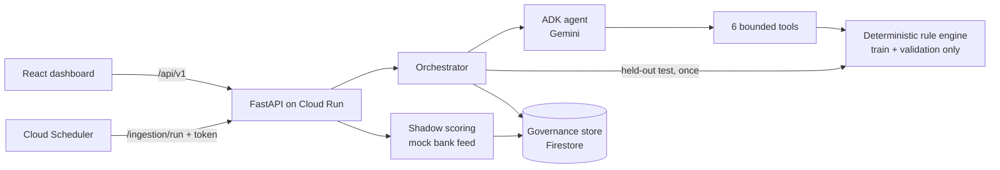

# RulePilot AI — Continuous Financial Rule Intelligence

**Fraud techniques change faster than detection rules.** RulePilot AI turns new financial-crime intelligence into tested, governed rule proposals. A Gemini agent reads a fraud advisory and finds gaps in the bank's existing rules. It then proposes candidate rules. Deterministic code measures every claim, and a human reviewer makes the final decision.

> **Live demo:** _URL added after the Cloud Run deployment._
> Built for the Google Cloud AI Builder Cup 2026, BFSI theme: *Intelligent Risk, Fraud & Financial Experiences*.
> All transaction data in this repository is **synthetic**. Metrics demonstrate the workflow and are not real-world detection rates.

```
advisory → structured findings → coverage-gap check → candidate rules
        → validation metrics → single held-out test → human review → audit
```

- **Gemini proposes.** A single Google ADK agent reads the advisory and works through a small set of bounded tools.
- **Code measures.** The rule engine validates every rule and computes every metric. The model never reports numbers itself.
- **Humans decide.** An approval is recorded, and the rule joins the reviewed catalog but is **never activated automatically**.

## What it does

| Scenario | What happens |
| --- | --- |
| **Card testing** advisory | The agent finds that the baseline (amount ≥ 1,500) misses small card-not-present bursts. It proposes up to three rules, checks them on the validation split, and the orchestrator tests the chosen rule **once** on the held-out split. Recorded live run: held-out recall **+5.4 pp**. |
| **SIM swap** advisory (FBI IC3) | On `payments-scenario-v3`, the SIM-change, device, credential-reset and payee fields make the advisory testable. Recorded run: a rule on a recent SIM change adds **+10.8 pp** recall. On `card-scenario-v2`, which has none of these fields, the run ends with **not testable** and no rule is invented. |
| Re-run after approval | Approved rules join the reference rule set and the agent reads earlier review decisions. If the behaviour is already covered, the result is **covered by existing rules**. This is governed learning; the model is never retrained. |
| Transaction monitor | A mock bank feed scores fresh synthetic transactions. Active rules make the decision. Approved rules run in **shadow mode**: they show what they *would* catch but never change the decision. |
| Scheduled ingestion | A token-protected endpoint lets Cloud Scheduler investigate new or changed advisories automatically. |

## Architecture



| Layer | Code |
| --- | --- |
| Intelligence: curated advisories with source URL, date, rights note and SHA-256; pasted advisories up to 8,000 characters; verbatim quote checks | `backend/app/intel/` |
| Agent: one ADK `LlmAgent` with 6 tools (rule catalog, review history, field coverage, training profile, candidate evaluation, final submission), retry and model fallback | `backend/app/agent/` |
| Rule engine: strict Pydantic rule schema, 6 comparison operators, AND/OR, fail-closed evaluation, confusion-matrix metrics | `backend/app/rules/`, `evaluation.py`, `backtest.py` |
| Data: versioned synthetic datasets with stratified 60/20/20 splits | `data.py`, `datasets.py` |
| Governance: reviews, reviewed rule catalog, append-only audit log, local JSON or Firestore storage | `governance.py`, `storage.py` |
| Shadow scoring and scheduled ingestion | `scoring.py`, `transactions_api.py`, `investigations_api.py` |
| Dashboard: investigations workspace, transaction monitor, rule-engine view | `frontend/src/` |

One Cloud Run service built from the root `Dockerfile` serves both the API and the dashboard.

## Safeguards

- **No code execution.** Rules are data validated against a schema. The agent cannot use network, file, shell, or database tools.
- **Advisories are treated as untrusted input.** Advisory text and reviewer comments are delimited in the prompt, and every evidence quote is checked verbatim against the source.
- **The agent's claims are re-checked in code.** Coverage is recomputed, and the selected rule must be one the agent actually evaluated. The status and headline are written by code, not by the model.
- **Evaluation integrity.** The agent sees only training statistics and validation results. The held-out test runs once, triggered by the orchestrator. Prompts and data are never tuned on test results.
- **Bounds.** At most 12 model calls, 120 seconds, 3 candidates and 3 conditions per rule, with an HTTP timeout on every model request.
- **Governance.** Candidate rules are drafts. Approval never activates a rule. Every step is audited.

## Data

| Dataset | Rows | Fraud | Notes |
| --- | --- | --- | --- |
| `synthetic-v1` | 120 | 41% | Small fixture for the rule-engine view |
| `card-scenario-v2` | 6,000 | 3.2% | High-value misuse and an **injected** card-testing pattern, 7 fields |
| `payments-scenario-v3` (default) | 30,000 | 3.3% | Adds an **injected** SIM-swap account-takeover pattern and 5 fields: `hour_of_day`, `new_device`, `days_since_sim_change`, `credential_resets_24h`, `new_payee`. Legitimate look-alikes exist for every fraud mode. The held-out split contains 202 fraud records. |

The patterns are injected on purpose, so the workflow can show what a detected coverage gap looks like. They are disclosed everywhere they appear.

## Run locally

Requirements: Python 3.11+, Node 22+, and optionally a Gemini API key from Google AI Studio.

```bash
# backend
cd backend
python3 -m venv .venv
.venv/bin/python -m pip install -r requirements-lock.txt
cp .env.example .env            # set GOOGLE_API_KEY to enable live investigations
.venv/bin/python -m uvicorn app.main:app --host 127.0.0.1 --port 8000

# frontend (second terminal)
cd frontend
npm ci
npm run dev                     # http://localhost:5173
```

Without a key, the dashboard still shows the recorded live runs, and live investigations are disabled. Interactive API docs are at `http://127.0.0.1:8000/docs`.

To run with Docker, as on Cloud Run:

```bash
docker build -t rulepilot-ai .
docker run -p 8080:8080 -e GOOGLE_API_KEY=... rulepilot-ai   # http://localhost:8080
```

## Checks

```bash
cd backend && .venv/bin/python -m pytest -q          # 112 tests, no Gemini calls
cd frontend && npm test && npx tsc -b && npm run build   # 14 tests
cd backend && .venv/bin/python scripts/golden_eval.py    # live golden set (needs a key)
cd backend && .venv/bin/python scripts/smoke_check.py http://127.0.0.1:8000
```

The golden set (`backend/app/golden.py`) re-runs each advisory against each dataset. It checks status, coverage, guardrails, verified quotes, held-out discipline, and whether the selected rule uses relevant fields. Held-out metric values are never used as pass/fail criteria.

## Deploy to Cloud Run

These commands assume a Google Cloud project with billing enabled.

```bash
gcloud services enable run.googleapis.com cloudbuild.googleapis.com secretmanager.googleapis.com artifactregistry.googleapis.com firestore.googleapis.com
gcloud firestore databases create --location=asia-southeast1
printf '%s' 'YOUR_GEMINI_KEY' | gcloud secrets create gemini-api-key --data-file=-
gcloud run deploy rulepilot-ai --source . --region asia-southeast1 --allow-unauthenticated \
  --memory 1Gi --timeout 300 --max-instances 2 \
  --set-env-vars GOOGLE_GENAI_USE_VERTEXAI=FALSE,RULEPILOT_STORE=firestore,GOOGLE_CLOUD_PROJECT=PROJECT_ID \
  --set-secrets GOOGLE_API_KEY=gemini-api-key:latest
```

Setting up the Cloud Scheduler job and verifying the deployment are covered in [agentic/skills.md](agentic/skills.md), skill 9.

## Limitations

- All transaction data is synthetic and includes injected patterns. Nothing here measures real-world detection, loss prevention, or return on investment.
- Public advisories describe techniques; they are not labelled ground truth.
- There is no authentication, and reviewer names are self-declared. A public deployment lets any visitor record reviews.
- Rules are numeric threshold conditions only. There is no real bank integration; the transaction feed is a mock.
- On the free tier, Gemini returns 429/503 errors, which the model fallback chain absorbs. Enable billing for reliable demos.

## Roadmap

- Re-backtest approved rules on new data windows to detect drift.
- Real transaction data in a secure environment, authentication, and reviewer identity.
- A rule-activation workflow with a second approver.
- Account takeover, scam, and AML typologies.

## Repository guide

| Path | Contents |
| --- | --- |
| `backend/` | FastAPI app, agent, rule engine, tests, scripts |
| `frontend/` | React + TypeScript + Vite dashboard |
| `agentic/` | Project context, guardrails, architecture, procedures, and tasks (also used by AI coding assistants) |
| `PROJECT_STATUS.md` | Submission checklist and remaining work |
| `IMPLEMENTATION_SUMMARY.txt` | Full implementation log |
